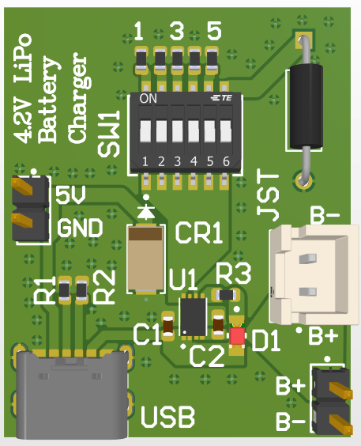
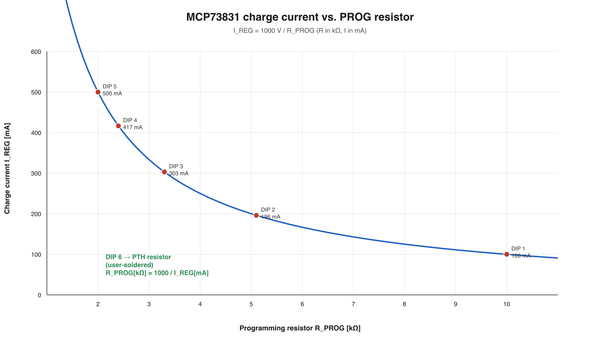
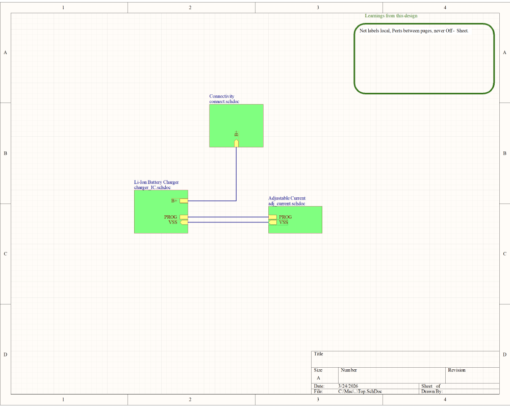
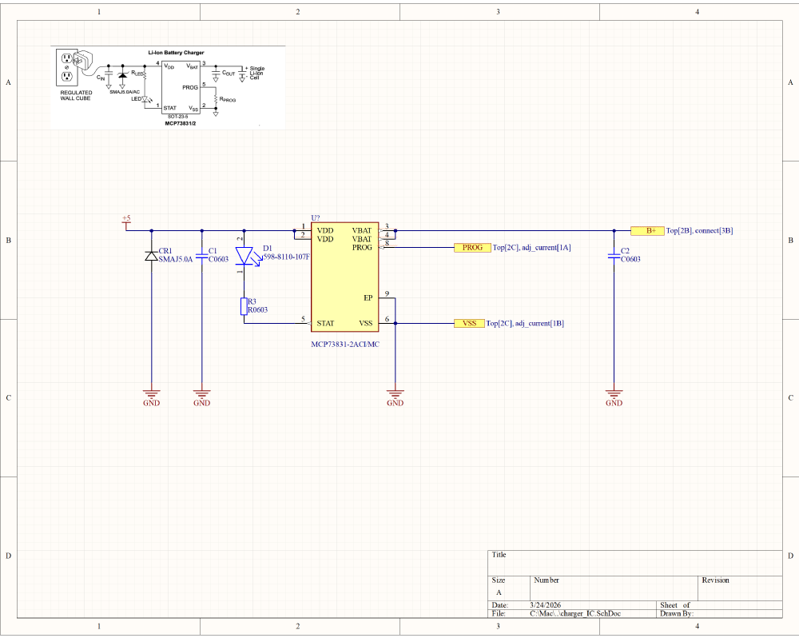
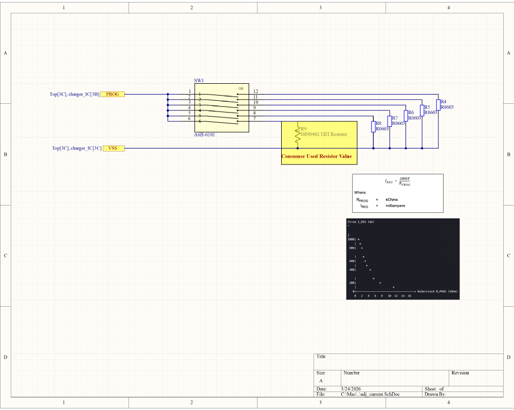
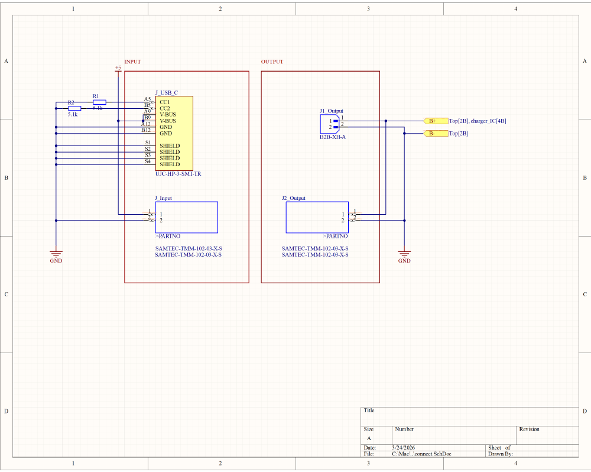

# DTU LiPo Charger v1.0 — USB-C Single-Cell Li-Ion/LiPo Charger


A complete, user-facing battery-charger **product**: a single-cell Li-Ion/LiPo
charger built around the **Microchip MCP73831**, with a **USB-C** input, five
DIP-selectable charge rates plus a user-solderable custom-rate position, two
battery-connection options (JST + PTH header), and a status LED. The exercise
covered the full product workflow — calculations, hierarchical schematic,
two-layer PCB and a written **user guide**.



> **Group 11 — co-designed.** This was a two-person group project for the DTU
> course *34374 IoT Hardware and PCB Design*. The product was co-designed
> end-to-end with my project partner **Louis Sønderby Pelletier**, who also
> authored the [user guide](docs/Group_11_LiPo_Charger_User_Guide.pdf). This
> repository is my personal showcase of our shared work; credit is shared.

---

## Design at a glance

| Parameter | Value |
|---|---|
| Product | DTU LiPo Charger v1.0 |
| Charger IC | MCP73831-2ACI/MC (2×3 DFN), 4.2 V regulation |
| Input | 5 V via USB-C **or** 2-pin PTH header |
| Battery | One single-cell Li-Ion / LiPo (4.2 V) |
| Charge current | 100 / 196 / 303 / 416 / 500 mA presets + custom (DIP-6) |
| Rate selection | 6-position DIP switch (A6H-6101) |
| Status | Red LED driven by the open-drain `STAT` pin |
| Protection | SMAJ5.0A TVS on input, IC thermal regulation & reverse-discharge protection |
| Battery connectors | JST XH (`B2B-XH-A`) **and** 2-pin PTH header |
| PCB | 2 layers, ≈ 28.2 mm × 34.9 mm |

---

## My contribution

This is a **shared Group 11 design**. Together with my partner I worked across
the whole product rather than one isolated slice:

- the charge-current calculations and E-series resistor selection,
- the hierarchical schematic (charger IC, adjustable current, connectors),
- the two-layer PCB layout, silkscreen and 3D review,
- the product definition and safety analysis.

The **user guide** in [`docs/`](docs/Group_11_LiPo_Charger_User_Guide.pdf) was
written by my project partner, Louis Sønderby Pelletier.

---

## 1. Charge-current programming

The MCP73831 sets its fast-charge current with a resistor on the `PROG` pin:

$$
I_{REG}\,[\text{mA}] = \frac{1000\ \text{V}}{R_{PROG}\,[\text{k}\Omega]}
\qquad\Longleftrightarrow\qquad
R_{PROG}\,[\text{k}\Omega] = \frac{1000}{I_{REG}\,[\text{mA}]}
$$

Five E-series resistors are fitted and selected one-at-a-time by DIP positions
1–5; position 6 connects a PTH resistor the user can solder for a custom rate.

| DIP | `R_PROG` | Target | Actual `I_REG` | Deviation |
|:--:|:--:|:--:|:--:|:--:|
| 1 | 10 kΩ | 100 mA | 100.0 mA | 0.0 % |
| 2 | 5.1 kΩ | 200 mA | 196.1 mA | −2.0 % |
| 3 | 3.3 kΩ | 300 mA | 303.0 mA | +1.0 % |
| 4 | 2.4 kΩ | 400 mA | 416.7 mA | +4.2 % |
| 5 | 2.0 kΩ | 500 mA | 500.0 mA | 0.0 % |
| 6 | user PTH | — | custom | — |

The E-series rounding keeps every preset within ~4 % of its nominal target —
well inside the MCP73831's own charge-current regulation tolerance, so the
standard values are a sound choice.



Reproduce the table and figure with `python3 analysis/charge_current_calc.py`.

## 2. Status LED

A single red LED on the open-drain `STAT` output reports the charger state:

| State | Condition | `STAT` pin | LED |
|---|---|---|---|
| Charging | Battery + 5 V, current flowing | Pulled LOW | **ON** |
| Charge complete | Battery fully charged | HIGH (off) | OFF |
| Shutdown | 5 V removed / UVLO | High-impedance | OFF |
| No battery | Nothing connected | HIGH | OFF |

This matches the datasheet recommendation of a single LED: **lit while
charging, off once charging finishes or the charger is unpowered.**

## 3. Battery chemistry & safety

**Chemistry compatibility.** The MCP73831-2 regulates the cell to **4.2 V**,
which is correct for single-cell Li-Ion/LiPo. A **LiFePO₄** cell has a nominal
3.2 V and must be charged to ~3.6 V, so this charger would **overcharge** it and
must not be used. Only one cell at a time is supported.

| Misuse | What happens | Design mitigation |
|---|---|---|
| Multiple DIP switches ON | `R_PROG` becomes the parallel combination → **lower** resistance, so the charge current rises above the selected setting (heat, cell stress) | Silkscreen and user guide instruct "only one switch at a time" |
| Two batteries connected (JST + PTH) | The cells are placed in **parallel**; an imbalance drives large cross-currents and the charger can no longer manage either cell | On-sheet note: *"Connect one battery via either the JST or the header — not both."* |
| LiFePO₄ cell | 4.2 V regulation overcharges it | Explicit chemistry warning in the user guide |
| Very high charge rate | Higher current → more heat and reduced cycle life | Guide recommends ≈ 1 C, 2 C maximum |

## 4. Hardware

### Hierarchical schematic

The design is split into four sheets — `Top.SchDoc` (the hierarchy) plus one
sheet per functional block — so the product stays readable as it grows. Ports
connect the sheets (`B+`, `PROG`, `VSS`), with a design note recording the
rule *"net labels local, ports between pages, never off-sheet."*

| Sheet | Function |
|---|---|
| `Top.SchDoc` | Top-level hierarchy connecting the three functional sheets |
| `charger_IC.SchDoc` | MCP73831, input/output capacitors, `STAT` LED, input TVS |
| `adj_current.SchDoc` | DIP switch + five preset `R_PROG` resistors + custom PTH resistor |
| `connect.SchDoc` | USB-C input, input header, JST + PTH battery connectors |

<table>
<tr>
<td></td>
<td></td>
</tr>
<tr>
<td></td>
<td></td>
</tr>
</table>

### PCB

The board is a compact **two-layer, ≈28.2 mm × 34.9 mm** design. The MCP73831
uses its 2×3 DFN package with the exposed pad stitched to the ground plane, the
USB-C receptacle sits on an accessible edge, and the JST, battery header and
input header are all reachable for the user. Silkscreen labels (`4.2V LiPo
Battery Charger`, `USB`, `JST`, `BAT+`/`BAT−`, `5V`/`GND`, and DIP positions
`1`–`6`) were placed so they stay legible in a single isometric 3D view — the
render at the top of this page is that check.

**Input protection & USB-C.** The brief specified a Micro-USB input; the team
implemented a **USB Type-C** receptacle (`UJC-HP-3-SMT-TR`) instead, with the
required **5.1 kΩ CC1/CC2 pull-down resistors** so the board correctly presents
itself as a USB-C sink. A **SMAJ5.0A** TVS diode protects the 5 V rail.

See [`docs/bom.md`](docs/bom.md) for the full component list and rationale.

## 5. User guide

The written deliverable is included as a PDF and is the best place to see the
product from a user's point of view:

**➡️ [Group 11 — LiPo Charger User Guide (PDF)](docs/Group_11_LiPo_Charger_User_Guide.pdf)**

It covers battery compatibility, the hardware overview, charge-rate selection
(including the `R_PROG` formula for custom rates), the charging procedure, the
status-LED meaning, and the safety warnings reproduced in section 3 above.

## 6. Repository contents

```
mcp73831-lipo-charger-product/
├── README.md
├── hardware/                              # Altium Designer source
│   ├── DTU_LiPo_Charger_v1.0.PrjPcb       # open this project
│   ├── Top.SchDoc                         # top-level hierarchy
│   ├── charger_IC.SchDoc                  # MCP73831 block
│   ├── adj_current.SchDoc                 # DIP + R_PROG presets
│   ├── connect.SchDoc                     # USB-C / headers / JST
│   ├── DTU_LiPo_Charger_v1.0.PcbDoc       # two-layer PCB
│   ├── LiPo_Charger.SchLib / .PcbLib      # symbols & footprints
│   └── README.md
├── docs/
│   ├── Group_11_LiPo_Charger_User_Guide.pdf
│   ├── design-notes.md
│   └── bom.md
├── analysis/
│   ├── charge_current_calc.py             # R_PROG table + figure
│   └── design_summary.json
├── tools/
│   └── altium_preview_to_png.py
└── images/
```

## 7. Reproducing the analysis

```bash
python3 analysis/charge_current_calc.py
```

No third-party packages are required. The script prints the preset table and
regenerates `images/charge-current-vs-rprog.svg` (render to PNG with
`inkscape ... --export-type=png`).

To inspect the hardware, open
`hardware/DTU_LiPo_Charger_v1.0.PrjPcb` in **Altium Designer**.

## 8. References

- Microchip — [MCP73831/2 datasheet (DS20001984)](https://www.microchip.com/en-us/product/MCP73831):
  mini single-cell Li-Ion/Li-Po charge-management controller.
- Course material: *34374 IoT Hardware and PCB Design*, Lecture 7 — Battery
  Charger Exercise, DTU.

---

### Attribution & academic use

Course project for **DTU 34374 IoT Hardware and PCB Design**, Group 11
(co-designed with Louis Sønderby Pelletier). Shared publicly for portfolio
purposes. If you are taking the course, please use it for reference only and
produce your own work.
